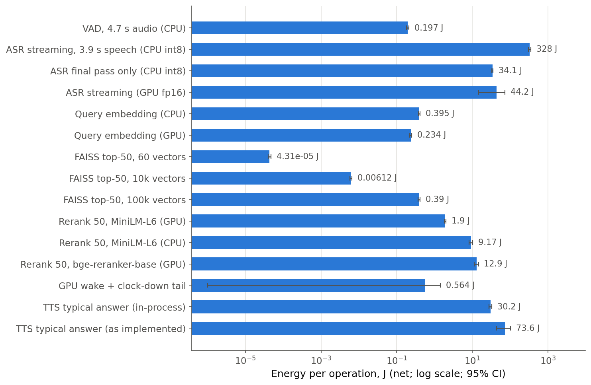
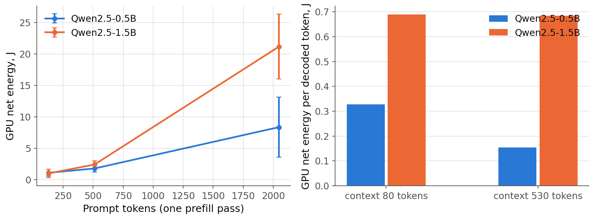
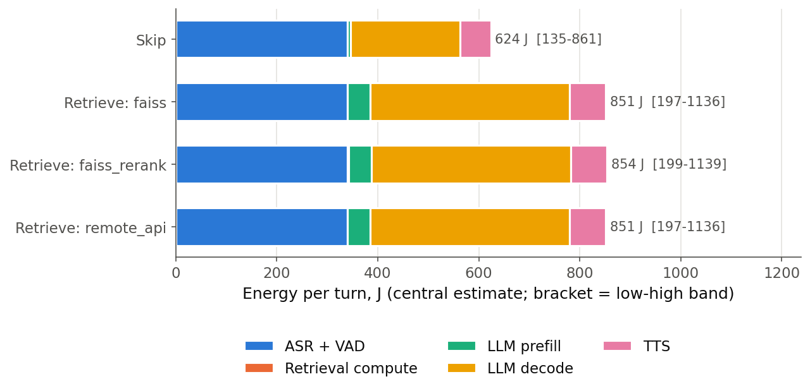
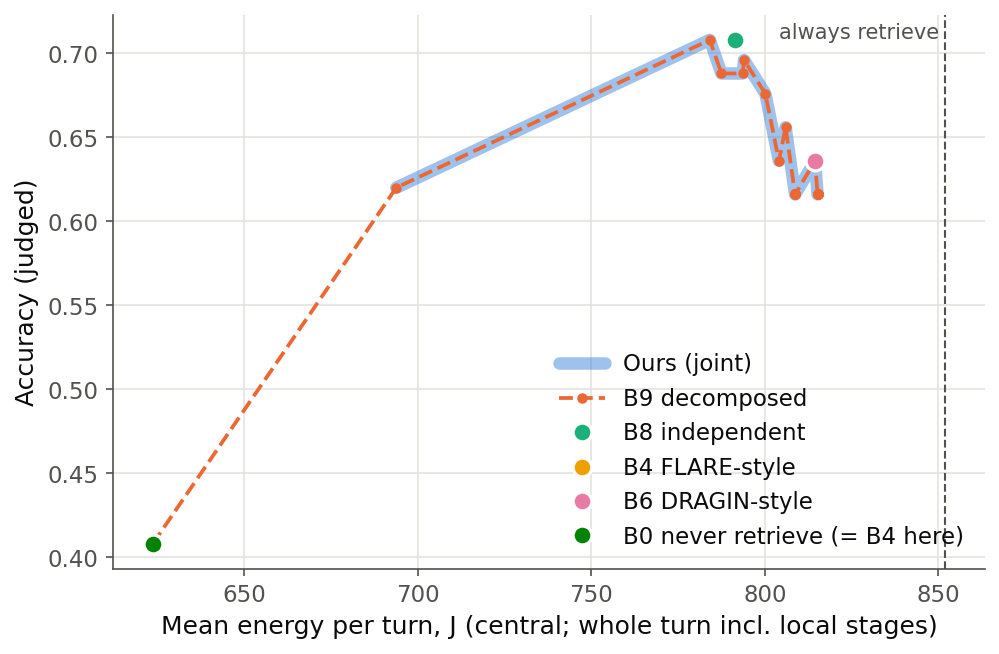

# Energy of the voice-RAG pipeline and of the retrieve/skip decision

Branch `v2/energy`. Reproducible from `energy/` (commands in section 8).
Numbers are joules (J) per operation or per turn, **net** of the idle floor of
the device doing the work, unless marked gross. Measured intervals are 95%
Student-t CIs over trials. Estimated quantities carry explicit low/high bands.

## 0. Answers first

1. **One retrieval costs about 227 J at the margin (band 62-274 J), or
   0.045 gCO2e (0.012-0.054) on the Indian grid.** This is for a hotel-domain
   turn with the `faiss` profile.
   - `faiss_rerank` adds 2.5 J.
   - `remote_api` adds about 0 J of compute; network energy is not modelled.
   - So **energy barely separates the three latency profiles (about 1%)**.
     They differ in latency, not in energy.
2. **Most of that energy is extra generation, not extra prefill.**
   - Retrieval adds 455 prompt tokens.
   - On the real E3 answers it also adds 23 generated tokens: answers get
     longer when passages are present.
   - On the A10G, prefill costs about 0.084 J/token and decode about
     7.7 J/token, a ratio of about 90x.

   Split of the 227 J (central):

   | retrieve - skip, by component | J | share |
   |---|---|---|
   | LLM decode of the longer answer (+23.1 tokens) | 177.5 | 78% |
   | LLM prefill of the passages (+455 tokens) | 38.2 | 17% |
   | TTS of the longer answer (+98 characters) | 11.2 | 5% |
   | Query embedding (bge-small, CPU) + FAISS search (60 vectors) | 0.39 | 0.2% |
   | Cross-encoder rerank of top-50 + GPU wake (`faiss_rerank` only) | 2.5 | 1% |

   - **Timing agrees.** On the production endpoint the 455 extra prompt tokens
     add only **188 ms** to time-to-first-token (median retrieve minus median
     skip, over 2,250 logged turns). The 23 extra answer tokens add about
     **0.76 s** of decode at 33 ms/token. So the 1.27-1.57 s paired TTFA
     increment seen in v1 E3 is the retrieval round trip plus generation, and
     the energy follows the generation part.
   - **With answer length held fixed**, retrieving costs about 39 J, almost
     all of it prefill. That is the only part a constant per-retrieval cost
     actually captures.
3. **λ_c = 0.05 quality units per retrieval implies about 2.2e-4 quality
   units per joule** (band 1.8e-4 to 8.1e-4). Equivalently, about 0.22 quality
   units per kJ, or about 1.1 quality units per gCO2e.
4. **Pricing compute in energy does not change the controller trade-off at
   present prices, and it does not reorder the controllers.**
   - Over the 56 real E3 operating points, mean turn energy is affine in
     retrieval rate: E ≈ 629 J + 231 J x rate.
   - An energy price is therefore just a rescaled λ_c (λ_c = λ_E x ~230 J).
     The frontier keeps its shape, and Ours and B9 still coincide (Fig. 3).
   - **What energy adds is per-item heterogeneity.** The marginal follows the
     change in answer length: about 15 J at p10 (answer 3 tokens shorter) and
     about 400 J at p90 (+46 tokens). An energy-aware controller should price
     the predicted change in answer length, or cap generation on retrieve
     turns, rather than charge a flat λ_c.
   - **The biggest energy levers are outside the retrieve/skip decision**
     (sections 3 and 5). As implemented, the local CPU streaming ASR costs
     328 J per utterance and the per-clause TTS process spawning costs about
     43 J per turn. Both are comparable to or larger than a retrieval.

## 1. What was measured, and on what

| Item | Value |
|---|---|
| Host | Laptop, Intel Core Ultra 7 155H (16 cores / 22 threads, 28 W processor base power), 16.6 GB RAM, Windows 11, on AC, "Balanced" power plan |
| GPU | NVIDIA GeForce RTX 4060 Laptop, 8 GB, driver 592.82, NVML 13.592.82. Default power limit 35 W, max 65 W; the enforced limit moved between 23 and 36 W during this work (dynamic boost). SM clock max 3105 MHz, memory 8001 MHz. Rest state P8 at 2.8-4 W, 56-59 C |
| Production LLM | Mistral-7B-Instruct-v0.3, bf16, vLLM 0.21.0, Modal `gpu="A10"` (A10G); deploy script `llm/modal_vllm.py` on `experiment1/modal-mistral-results` |
| Software | Worktree venv `.venv-energy` (Python 3.10, gitignored): torch 2.9.1+cu126, faster-whisper 1.2.1 / ctranslate2 4.8.3, sentence-transformers 5.7.0, faiss-cpu 1.15.1, piper-tts 1.8.0, silero-vad, transformers 4.57.6, nvidia-ml-py 13.615.71 |

**The host was shared with other research jobs throughout** (retrieval
latency sweeps, speech rendering, ASR tracing), some of them on the GPU.
- RAM was exhausted at times. Two benchmark processes died (`mkl_malloc`,
  "paging file too small"), and the host restarted three times.
- During the runs the CPU package drew 30-45 W at "idle", with 9-21 of 22
  logical CPUs busy with other work.

The protocol was designed to survive this. Every result records the
contention it saw (idle floors, flagged trials, kappa).

## 2. Instrumentation

### GPU: NVML sampler (`energy/sampler.py`)

**Achieved sampling rate.** A background thread polls
`nvmlDeviceGetPowerUsage`. Measured in `results/sampler_probe.json` (idle /
under load):

| Requested rate | Achieved rate |
|---|---|
| 20 Hz | 19.9 / 20.0 Hz |
| 50 Hz | 49.4 / 49.9 Hz (stage runs averaged 46-50 Hz) |
| 100 Hz | 94 / 96 Hz |
| 200 Hz | 143 / 157 Hz (limited by Python) |

**Effective resolution is lower than the sampling rate.**
- On this laptop driver, NVML's power value **refreshes only every ~500 ms**,
  whatever the polling rate. A square-wave test showed <= 0.25 s reporting
  lag.
- Polling at 20-50 Hz therefore oversamples a 2 Hz step signal.
- Energy is the trapezoidal integral with interpolated window edges
  (`integrate_trapezoid`, unit-tested). Operations shorter than the refresh
  interval are measured by repetition (see Protocol).

**NVML's cumulative energy counter is distorted by polling on this driver.**
In the same GPU state (another job holding ~21 W):

| Counter read | Counter slope | Reported power |
|---|---|---|
| at window boundaries only | 25.0 W | 21.4 W |
| polled at 1 Hz | 25.3 W | 21.2 W |
| polled at 10 Hz | 58.0 W | 23.2 W |
| polled at 100 Hz | 176 W | 25.2 W |

- The first, polled version of the probe is kept as
  `sampler_probe_v0_polled_counter.json`. In it, a 6 s matmul load integrated
  to 140 J from power but to 600-1500 J from the counter.
- Read only at window boundaries, the counter agrees with the power integral
  within 4.5-6.6% under load.
- It is kept as a cross-check (`gpu_j_counter`), not as the headline value.

**The GPU clock-down tail is real energy.**
- After work the GPU stays at about 15 W for 1-2 s, against 3-4 W at rest.
- Idle windows are therefore taken only after the GPU is back at rest
  (`settle_gpu`).
- The tail is reported once per burst: **GPU wake + tail = 0.56 J
  [-0.30, 1.42]** for a single embed from rest.

**Recorded metadata.** At the start and end of every stage the sampler records
the GPU name, driver, NVML version, SM and memory clocks (current and max),
temperature, P-state, and the enforced and default power limits.

### CPU: options evaluated

| Option | Verdict |
|---|---|
| Linux RAPL powercap | Not available on Windows |
| Intel Power Gadget / CodeCarbon's RAPL path | Power Gadget is discontinued; CodeCarbon on Windows then falls back to TDP x CPU load |
| LibreHardwareMonitor / WinRing0 MSR reads | Need admin rights plus a kernel driver on Microsoft's vulnerable-driver blocklist; not used |
| **Windows Energy Meter Interface (EMI) counters** | **Used** (`energy/winpdh.py`). `\Energy Meter(RAPL_Package0_PKG)\Energy` exposes the RAPL package accumulator to user mode, no admin rights needed. Calibrated here: unit = picowatt-hours, time counter = ms, update every ~8-16 ms. PP0 (cores) is available; DRAM reads 0 |
| CodeCarbon-style TDP x utilisation | Used as the **low band**: 28 W / 22 logical CPUs = 1.27 W per busy logical CPU |

**Why RAPL marginals could not be used directly.** Other jobs held the CPU
package at its power limit (~40 W). Adding work therefore **did not raise
package power**; it displaced other processes' cycles. The RAPL marginal
reads near zero or negative: ASR streaming shows 55 J [-9, 119] for 114
CPU-seconds of work.

**CPU energy is therefore an attribution:**

    cpu_attr = (CPU-seconds of this process per op, net of the sampler thread)
               x kappa,   kappa = package W / busy logical CPUs in the same window

- Measured kappa was 1.9-4.2 W per busy logical CPU (median about 2.5).
- When the package was not saturated, attribution and the RAPL marginal
  agreed. In the GPU-embedding run, CPU energy was 0.085 J attributed vs
  0.087 J RAPL marginal.
- Child-process CPU time is read from the process handle. This matters for the
  subprocess TTS. The venv redirector is bypassed so that the real interpreter
  is the direct child.

**Bands for CPU stages.**
- Low = min(TDP share, RAPL marginal if > 0).
- High = 1.5 x central. This is a judgement: an uncontended machine runs at
  higher clocks and voltage per CPU-second.
- Overall uncertainty is about -60% / +50% around the central value.
- RAPL covers the package only. DRAM, platform, display and AC-adapter losses
  are not measured.

### Protocol (`energy/protocol.py`)

- **Paired windows.** Each trial is idle (after GPU settle), then active, then
  idle. The active energy is netted against the mean of the two flanking idle
  windows, so slow drift cancels.
- **Repetition.** Operations shorter than the NVML refresh run K times inside a
  ~4-5 s active window, and the energy is divided by K. A 0.5-0.75 s tail
  inside the window catches the reporting lag.
- **Trials.** 8-10 per stage. The trial is the unit of the CI.
- **Contention flag.** A trial is flagged as GPU-contended when a flanking
  idle exceeds the session rest power + 2 W. Flagged trials are excluded and
  counted. If all trials are flagged, all are used and the record says so.
- **CPU-only stages carry no GPU term.** On this host their GPU "net" was
  other jobs' noise.

## 3. Per-stage energy on the laptop (`results/stages.json`, Fig. 1)

**Test utterance:** "Hi, can I check in early tomorrow morning, and is there
an extra fee?", rendered once by piper. It is 3.81 s of speech plus 0.8 s of
trailing silence at 16 kHz, and is not committed.

**Configuration is production unless stated:**
- ASR: faster-whisper *small* on CPU int8. Partial re-transcription every
  400 ms with beam 1, then a final pass with beam 5, exactly as
  `audio/stt.py` does it.
- Embedding: bge-small on CPU with 4 torch threads (the v2 `faiss` profile).
- Rerank: MiniLM-L6 on CUDA (the v2 `faiss_rerank` default).

| Stage | Latency per op | CPU-s per op | CPU attributed J | CPU RAPL marginal J | GPU net J | **Total net J, central [95% CI]** | trials (flagged) |
|---|---|---|---|---|---|---|---|
| VAD (Silero), 4.6 s audio, CPU | 129 ms | 0.093 | 0.197 [0.183, 0.212] | 0.05 [-0.08, 0.18] | - | **0.197 [0.183, 0.212]** | 10 (0) |
| ASR streaming, 3.8 s speech, CPU int8 | 29.0 s | 114 | 328 [305, 351] | 55 [-9, 119] | - | **328 [305, 351]** | 8 (0) |
| ASR final pass only, CPU int8 | 3.51 s | 14.2 | 34.1 [32.9, 35.2] | 0.4 [-1.8, 2.6] | - | **34.1 [32.9, 35.2]** | 8 (0) |
| ASR streaming, GPU fp16 | 2.19 s | 2.2 | 9.9 [6.6, 13.3] | 2.0 [-6.9, 10.9] | 34.3 [8.2, 60.4] | **44.2 [14.7, 73.7]** | 8 (5) |
| Query embedding, CPU | 20.6 ms | 0.084 | 0.395 [0.378, 0.412] | 0.072 [0.035, 0.109] | - | **0.395 [0.378, 0.412]** | 8 |
| Query embedding, GPU | 21.3 ms | 0.021 | 0.085 [0.079, 0.092] | 0.002 | 0.149 [0.138, 0.159] | **0.234 [0.217, 0.252]** | 8 (0) |
| FAISS flat top-50, 60 vectors (current corpus) | 10.5 us | 1.0e-5 | 4.3e-5 | 3.0e-5 | - | **4.3e-5 [3.9e-5, 4.7e-5]** | 8 (0) |
| FAISS flat top-50, 10k vectors | 1.57 ms | 0.0015 | 0.0061 | 0.0013 | - | **0.0061 [0.0057, 0.0065]** | 8 (0) |
| FAISS flat top-50, 100k vectors | 15.1 ms | 0.174 | 0.39 | 0.12 [0.10, 0.14] | - | **0.39 [0.37, 0.41]** | 8 (0) |
| Rerank 50 pairs, MiniLM-L6, GPU | 69.6 ms | 0.099 | 0.40 | 0.14 | 1.51 [1.45, 1.57] | **1.90 [1.81, 2.00]** | 8 (0) |
| Rerank 50 pairs, MiniLM-L6, CPU | 1.34 s | 3.69 | 9.17 [8.14, 10.2] | 1.7 [-1.3, 4.7] | - | **9.17 [8.14, 10.2]** | 8 (0) |
| Rerank 50 pairs, bge-reranker-base, GPU | 670 ms | 0.44 | 0.89 | 0.46 | 12.0 [10.6, 13.4] | **12.9 [11.3, 14.6]** | 8 (0) |
| GPU wake + clock-down tail (once per GPU burst) | 1.6 s window | - | - | - | 0.56 [-0.30, 1.42] | **0.56 [-0.30, 1.42]** | 8 |
| TTS piper, short answer (94 chars), in-process | 0.85 s | - | 14.8 [11.7, 17.8] | ~0 | - | **14.8 [11.7, 17.8]** | 8 |
| TTS piper, typical answer (233 chars), in-process | 1.46 s | 15.6 | 30.2 [27.5, 32.9] | ~0 | - | **30.2 [27.5, 32.9]** | 8 (0) |
| TTS piper, long answer (332 chars), in-process | 2.08 s | - | 42.0 [38.0, 46.1] | <0 | - | **42.0 [38.0, 46.1]** | 8 |
| TTS typical answer **as implemented** (one `python -m piper` process per clause, 3 clauses) | 7.42 s | 24.0 | 73.6 [43.6, 104] | ~0 | - | **73.6 [43.6, 104]** | 8 |

- In-process TTS fits about 4.4 J + 0.114 J per character. The as-implemented
  version adds a further ~43 J per turn of process spawning.
- Under contention, the CPU ASR stream was far from real time: 29 s of compute
  for 3.8 s of speech. That is also a latency problem.
- The GPU ASR stream had 5 of 8 trials flagged for contention, so its CI is
  wide.



*Fig. 1. Net energy per operation, log scale. CPU stages use attributional
CPU energy. GPU stages use NVML net energy plus attributed CPU. Bars show 95%
CIs.*

## 4. LLM energy (remote A10G)

### 4a. In-container sampler patch (written, not deployed)

**`energy/serving/gpu_energy.py`**
- `GpuEnergyMonitor` polls NVML at 20 Hz into a ring buffer and writes a 1 Hz
  `timeline.jsonl` (power, energy, in-flight count, SM clock, temperature).
- `EnergyMiddleware` is pure ASGI, with the same shape as the existing
  `BearerAuthMiddleware`. For each `/v1/(chat/)completions` request it logs:
  - the wall-clock window;
  - the energy-counter delta and the power integral, plus their ratio, so the
    A10G driver's counter can be validated before it is trusted;
  - the idle floor and net J;
  - the in-flight maximum (energy is exclusive to one request only when this
    is 1);
  - `prompt_tokens` and `completion_tokens`, parsed from the body or from the
    final SSE usage chunk;
  - an `x-energy-request-id` response header.
- `GET /energy/requests?since=` returns the log.
- It is unit-tested with a fake NVML.

**`energy/serving/modal_vllm_energy.py`**
- Starts from the `experiment1/modal-mistral-results:llm/modal_vllm.py`
  (9149692) deploy script, with model, revision, vLLM version, dtype, limits,
  GPU and auth unchanged.
- Adds:
  - `nvidia-ml-py` and the `energy` package to the image;
  - a `voice-rag-energy-logs` volume;
  - a second `--middleware`, with auth outermost so the log endpoint is also
    authenticated;
  - `max_containers=1`.
- Before use: clients must send `stream_options.include_usage`, and the
  middleware ordering must be checked against vLLM 0.21.

### 4b. Estimate: energy(request) ≈ prefill_tokens x e_prefill + gen_tokens x e_decode (+ idle share)

Each coefficient is `e = (P_phase - P_idle) x t_phase_per_token`
(`energy/llm_estimate.py`).

**Timing is observed, not modelled.** Source: `results/a10g_timing.json`,
built from the E2 and E3 logs (2,250 turns, 750 of them skip turns, all
Mistral-7B on the Modal A10G).
- **Decode: 33.0 ms/token median** (p10-p90 32.3-33.5).
  - Streaming the 14.5 GB of bf16 weights once per step in 33 ms is 439 GB/s,
    73% of the A10G's 600 GB/s.
  - That is consistent with memory-bound batch-1 decode.
- **Prefill: 0.41 ms/token.**
  - Median TTFT is 969 ms for retrieve turns and 781 ms for skip turns. WAN
    round trip and client overhead cancel in the difference.
  - 188 ms / 455 tokens = 0.41 ms/token, about 50% of the A10G's ~70 TFLOPS
    dense BF16 at 2N FLOP per token.

**Power is the estimated part:**

| Scenario | P_decode | P_prefill | Basis |
|---|---|---|---|
| high | 300 W | 300 W | A10G board power limit |
| **central** | **293 W** | **263 W** | f x 300 W, where f = phase power / enforced limit, measured on the RTX 4060 with dispatch-free proxy kernels (`bench_phase_power.py`): bf16 GEMV over 2 GiB (decode-like, memory-bound) gave f = 0.975; bf16 GEMM 512x4096x4096 (prefill-like) gave f = 0.878 |
| low | 146 W | 132 W | f x 150 W: as if the board drew like the NVIDIA A10, which has the same GA102 die and 600 GB/s GDDR6 at a 150 W TDP |

A10G idle power (container up, model resident) is **assumed** to be 60 W,
range 30-90 W. In the bands it is paired against power so that the net band is
as wide as possible.

| Coefficient (net of idle) | low | **central** | high |
|---|---|---|---|
| e_decode, J/token | 1.86 | **7.68** | 8.92 |
| e_prefill, J/token | 0.017 | **0.084** | 0.112 |

**The central value is probably on the high side.**
- A 30-36 W laptop GPU sits at its limit for nearly any saturating kernel, and
  the proxies ran while another job was using the GPU.
- vLLM batch-1 decode at 73% of peak bandwidth need not draw 98% of a 300 W
  board.

**Local small-model measurements** (`bench_llm.py`, `results/llm_local.json`,
Fig. 4): Qwen2.5-Instruct in bf16 with HF `transformers` on the 4060.

| Model | Prefill J/token (linear fit over 128-2048 tokens) | Decode J/token (context 80 / 530) | Decode ms/token | Effective bandwidth |
|---|---|---|---|---|
| 0.5B | 0.0039 | 0.33 / 0.15 | 137 / 131 | 7 GB/s |
| 1.5B | 0.0110 | 0.69 / 0.68 | 137 / 145 | 22 GB/s |

- **They confirm the shape of the cost.**
  - Prefill energy is linear in prompt length.
  - A decoded token costs 40-80x a prefilled one.
  - Per-token energy scales roughly with parameter count (prefill x2.8 for
    x3.1 parameters).
  - Scaled linearly to 7.25 B parameters on this laptop, they give about
    0.05 J/token prefill and 3.2 J/token decode. That lies between the A10G
    low and central scenarios.
- **They are not used numerically.** On this host they were launch-bound and
  contended:
  - about 137 ms/token whatever the model size;
  - about 0.1 CPU-s of Python dispatch per forward pass;
  - another job running on the GPU.

  They serve only as the fallback for f if the proxy-kernel file is missing.
- **A 4-bit Mistral-7B was not possible:** the HF repo is gated and no token is
  configured. Exact Mistral token counts come instead from the ungated v3
  SentencePiece tokenizer shipped in `mistral_common`.

**This power estimate is the dominant uncertainty in the whole report.** The
4a patch is what removes it.



*Fig. 4. Local Qwen2.5 measurements on the RTX 4060 Laptop, used as a shape
check only.*

## 5. The energy model API (`energy/model.py`, parameters in `energy/params.json`)

```python
from energy.model import turn_energy_j, marginal_retrieval, implied_quality_per_joule
e = turn_energy_j("retrieve", "faiss", n_prompt_tokens=534, n_gen_tokens=51,
                  asr_seconds=3.9, tts_chars=217)
e["components"]["llm_decode"]      # {"central": ..., "low": ..., "high": ...}  J
e["total_j"], e["local_j"], e["remote_j"], e["g_co2e"], e["grid_factor"]
```

**Components**
- `vad` and `asr` (per second of speech).
- `tts` (fixed cost + per character).
- `retrieval_embed` and `retrieval_search` (index size `60|10k|100k`).
- `retrieval_rerank` (`faiss_rerank` only). In the production placement it
  includes the GPU wake/tail, because nothing else is on the GPU.
- `retrieval_network` (`remote_api` only; 0 by default).
- `llm_prefill` and `llm_decode`.
- With `include_idle=True, turn_wall_s=...`, also gross `idle_local` and
  `idle_remote_gpu`.

**Options**
- `pue` multiplies remote energy. The default 1.0 counts board energy only.
- `remote_grid_g_per_kwh` sets the remote GPU's grid. The Modal region's grid
  is unknown, so the India factor is used by default.
- `params=` takes an alternative parameter set. `params_gpu_placement.json`
  puts ASR and embedding on the GPU (ASR 44 J instead of 328 J per utterance)
  and adds a per-turn GPU wake.
- Component lows and highs are summed, i.e. treated as perfectly correlated.
  This is conservative.

**Grid factor** (`energy/grid_factors.json`, configurable)
- **Default: 710 gCO2/kWh.** CEA *CO2 Baseline Database for the Indian Power
  Sector*, **Version 21.0**: all-India weighted average including renewables
  and captive generation, FY 2024-25,
  <https://cea.nic.in/wp-content/uploads/baseline/2025/12/User_Guide_V_21.0.pdf>.
  The CEA PDF was behind a login when accessed (2026-10-15), so 0.710 comes
  from secondary summaries; one of them gives 0.7117.
- **Alternative: 727 g/kWh, Version 20.0** (FY 2023-24), read directly from
  Table S of that version's user guide. Its combined margin, 757 g/kWh, is
  included for a marginal-emissions sensitivity.
- CEA Version 22.0 (FY 2025-26) exists, but its figures could not be
  retrieved. Replace the default once they can be.

### Whole-turn picture (Fig. 2; mean hotel turn, 3.94 s of speech)

| Turn | Central J | Band J | gCO2e central (band) |
|---|---|---|---|
| Skip | 624 | 135-861 | 0.123 (0.027-0.170) |
| Retrieve, `faiss` | 851 | 197-1136 | 0.168 (0.039-0.224) |
| Retrieve, `faiss_rerank` | 854 | 199-1139 | 0.168 |
| Retrieve, `remote_api` | 851 | 197-1136 | 0.168 |

- In a skip turn, **ASR as implemented is 339 J (54%)** and LLM decode is
  217 J. The local CPU streaming ASR, which re-transcribes the growing buffer
  every 400 ms, costs more energy than the remote LLM.
- TTS as implemented spends about 43 J per turn just starting processes.



*Fig. 2. Energy per turn by component. Retrieval compute is too small to see.
The bracket next to each bar gives the low-high band.*

## 6. Accuracy vs energy, and what λ_c = 0.05 means

Every decision in the real E3 sweep was re-priced in joules, using that
decision's own prompt and answer token counts. The sweep covers 6
controllers, 5 seeds x 50 scenarios, with judged accuracy
(`energy/frontier.py`, `results/frontier.json`).

- Best accuracy is 0.708, at 784-791 J/turn (B8, and B9/Ours at their best λ).
  Never-retrieve reaches 0.408 at 624 J.
- Retrieving more than about 70% of the time lowers accuracy *and* raises
  energy.
- Ours and B9 coincide, as in v1 E3. Energy pricing cannot separate them,
  because turn energy is affine in retrieval rate (E ≈ 629 + 231 x rate,
  central).



*Fig. 3. Accuracy against mean whole-turn energy for the E3 controllers. Ours
(wide band) and B9 (dashed) overlap. B4 never fired, so it sits on B0.*

**Implied energy price**
- λ_c = 0.05 quality units per retrieval, divided by ΔE ≈ 227 J (central),
  gives **2.2e-4 quality units/J**. That is 1.8e-4 at the high-energy band and
  8.1e-4 at the low band, or about 1.1 quality units per gCO2e.
- Compare retrieval's quality effect measured in v1 E3: +0.72 on items that
  need it, -0.59 on items that do not. The energy price would have to be
  **about 14x higher** (3.2e-3 quality units/J) before one retrieval's energy
  cost equalled its gain on an item that needs it.
- At the current λ_c, decisions are driven by VOI and latency (λ_l). The
  compute/energy term only tips items whose VOI is within about 0.05 of the
  latency cost.

**Does energy materially change the controller trade-off? No, with two
qualifications.**
1. **Retrieval's energy is not a constant.**
   - It is about 39 J intrinsic (prefill + search) plus about 7.7 J for each
     extra answer token the passages induce.
   - Per-item marginals span roughly 15-400 J.
   - A controller priced in energy should price the predicted change in answer
     length, or cap `max_tokens` on retrieve turns.
2. **Bigger levers exist outside the decision.** Each of these is comparable
   to or larger than the whole marginal cost of a retrieval:
   - ASR placement and implementation: 328 J on CPU vs 44 J on GPU per 3.8 s
     utterance, mostly from re-transcribing partials;
   - loading the TTS voice once instead of spawning a process per clause:
     saves about 43 J per turn;
   - answer brevity: about 7.7 J per token on the A10G.

## 7. Assumptions and uncertainties

| # | Assumption | Affects | Uncertainty |
|---|---|---|---|
| 1 | A10G phase power = f x 300 W (central), with f from laptop proxy kernels | e_decode, e_prefill | **Dominant.** Band x0.24 to x1.16 on e_decode; removed by deploying the 4a patch |
| 2 | A10G idle is 60 W (30-90 W) | Net subtraction, gross idle | +-1 J/token on decode |
| 3 | Server decode time = observed streamed inter-token time | e_decode | Upper bound; inter-token sd about 1 ms |
| 4 | Prefill time = median TTFT difference (retrieve - skip) | e_prefill | Medians over different scenario mixes; +-30% |
| 5 | CPU energy is attributional (CPU-s x measured kappa) | All CPU stages | -60% / +50%; host contended, package at its power cap |
| 6 | CPU-only stages have no GPU term | Removes other jobs' noise | None in expectation |
| 7 | ASR energy is linear in speech seconds | `asr_j_per_audio_s` | Streaming cost grows faster than linear (re-transcription up to the 8 s cap); only one length measured |
| 8 | TTS energy is linear in characters | `tts_j_per_char` | Fitted over 3 lengths |
| 9 | `remote_api` = faiss compute on a server (scale 0.5-2x, times PUE), network energy 0 | `remote_api` | Network not modelled; attributional per-GB intensities would add about 0.1-1 J per call but are not marginal |
| 10 | India grid factor also applied to the remote GPU | About half of gCO2e | Datacentre grid unknown; override provided |
| 11 | Hotel-domain token budget (+455 prompt, +23 answer tokens) | Marginal | The answer-length effect is domain-specific; rerun `energy.tokens` on the v2 datasets |
| 12 | Not measured: DRAM, platform, display, AC adapter; datacentre PUE | All | Typically +10-40% locally; PUE 1.1-1.6 remotely |

## 8. Files and reproduction

```
energy/winpdh.py            Windows EMI/RAPL reader (pWh -> J)
energy/sampler.py           NVML + RAPL sampler, integration math, `with measure("stage")`
energy/protocol.py          paired idle/active protocol, GPU settle, CPU attribution, CIs
energy/probe_sampler.py     achievable rate, NVML refresh interval, counter artefact
energy/bench_stages.py      per-stage measurements (energy/run_all_stages.py: one process per stage)
energy/bench_phase_power.py proxy-kernel phase power for the A10G transfer
energy/bench_llm.py         local Qwen2.5 prefill/decode energy (shape check)
energy/a10g_timing.py       A10G timings from E2/E3 logs (needs the gitignored logs/ dir)
energy/tokens.py            exact Mistral token budget, skip vs retrieve
energy/llm_estimate.py      A10G e_prefill / e_decode scenarios
energy/fit_params.py        -> energy/params.json, energy/params_gpu_placement.json
energy/model.py             the API; energy/grid_factors.json holds the cited factors
energy/frontier.py          E3 accuracy vs energy; energy/make_figures.py writes figures + tables
energy/serving/             in-container sampler + Modal deploy variant (NOT deployed)
tests/test_energy.py        integration math, protocol, middleware, API (23 tests)
```

```
PYTHONUTF8=1 .venv-energy/Scripts/python.exe -m energy.run_all_stages
PYTHONUTF8=1 .venv-energy/Scripts/python.exe -m energy.bench_phase_power
PYTHONUTF8=1 .venv-energy/Scripts/python.exe -m energy.bench_llm --models 0.5B
PYTHONUTF8=1 .venv-energy/Scripts/python.exe -m energy.a10g_timing --logs <main checkout>/logs
PYTHONUTF8=1 .venv-energy/Scripts/python.exe -m energy.tokens
PYTHONUTF8=1 .venv-energy/Scripts/python.exe -m energy.fit_params
PYTHONUTF8=1 .venv-energy/Scripts/python.exe -m energy.frontier
PYTHONUTF8=1 .venv-energy/Scripts/python.exe -m energy.make_figures
PYTHONUTF8=1 .venv-energy/Scripts/python.exe -m pytest tests/test_energy.py
```

- Model weights live in `~/.cache/voice-rag-energy`, outside the repo and
  OneDrive. Override with `VOICE_RAG_ENERGY_CACHE`.
- Nothing was deployed, and no remote endpoint was called.

**Sources**
- NVIDIA A10 (150 W, 600 GB/s, 125 TF dense BF16), Lenovo Press LP1816:
  <https://lenovopress.lenovo.com/lp1816-thinksystem-nvidia-a10-24gb-pcie-gen4-passive-gpu>
- A10G (300 W board power, 600 GB/s, ~70 TF dense FP16):
  <https://getdeploying.com/gpus/nvidia-a10g>
- A10 vs A10G (same VRAM and bandwidth):
  <https://modal.com/blog/nvidia-a10g-price-article>
- CEA CO2 Baseline Database user guides v20.0 and v21.0: URLs above and in
  `energy/grid_factors.json`.
